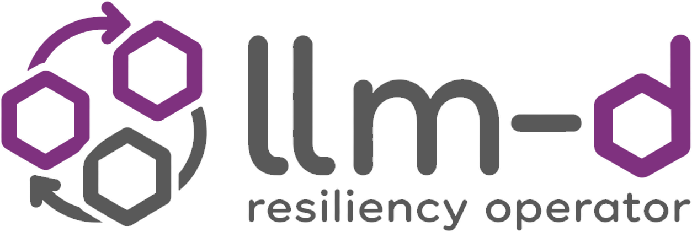

<div align="center">



<p>A Kubernetes operator that detects and recovers from failures in llm-d inference workloads.</p>

[](https://github.com/llm-d-incubation/llm-d-resiliency-operator/actions/workflows/ci-pr-checks.yaml)
[](https://llm-d-incubation.github.io/llm-d-resiliency-operator/docs/)
[](LICENSE)

</div>

The llm-d Resiliency Operator (IRO) keeps a multi-node inference engine serving through faults. When a member
fails, IRO removes it in place so the rest keep serving, then resets the failed Pod and brings the group back to
full capacity. It restarts the whole group only when nothing else can work.

> [!NOTE]
> IRO is in early development under [llm-d-incubation](https://github.com/llm-d-incubation). Background:
> [proposal](https://github.com/llm-d/llm-d/blob/main/docs/proposals/inference-resilience-operator.md),
> [design doc (WIP)](https://docs.google.com/document/d/1q4V2CcWMSrufy5LJE_Fv49kwCoFoPSTrBrrayzNxRqY/edit?usp=sharing),
> [llm-d](https://github.com/llm-d/llm-d).

## How it works

<p align="center">
  
</p>

- **Remove in place.** When the engine reports members dead, one reconfig removes them. The rest keep serving.
- **Restore capacity.** The group now serves with fewer members. IRO restarts the failed Pods and adds their new members back.
- **Reset as a last resort.** If nothing can be removed safely, or a recovery fails, IRO restarts the whole group.
- **Act only on what it sees.** IRO removes a member only when the engine reports it dead, and resets a group only when it can list its Pods.

Step through this recovery call by call in the
[interactive example](https://llm-d-incubation.github.io/llm-d-resiliency-operator/docs/failures/member-dies/),
or browse [every failure IRO handles](docs/failures/index.md).

<details>
<summary><b>Architecture</b></summary>

<br/>


The controller knows no engine and no workload type. It talks to them through plugins, and keeps its state in a
versioned journal so a new leader picks up a recovery where the old one stopped. See
[Architecture](docs/README.md) and [Components](docs/components/index.md).

</details>

## Supported

| Plugin | Implementations |
|---|---|
| Engine | [vLLM](docs/components/engines/vllm.md), [SGLang](https://github.com/llm-d-incubation/llm-d-resiliency-operator/pull/56) (WIP) |
| Workload | [LeaderWorkerSet](docs/components/workloads/lws.md) |

## Quick start

```bash
git clone https://github.com/llm-d-incubation/llm-d-resiliency-operator.git
cd llm-d-resiliency-operator
make build    # make help lists every target

# run with engine fault recovery on
manager --leader-elect --enable-engine-ft --engine=vllm --workload=lws
```

Flags and setup: [Getting started](docs/getting-started.md) and
[controller configuration](docs/components/controller.md#configuration).

## Documentation

- [Architecture](docs/README.md): the controller, its plugins and a fault end to end
- [Components](docs/components/index.md): controller, workload, engine, journal, telemetry
- [Failures](docs/failures/index.md): every failure IRO handles, step by step
- [Docs site](https://llm-d-incubation.github.io/llm-d-resiliency-operator/docs/): the same docs, with interactive examples

## Contributing

See [CONTRIBUTING.md](CONTRIBUTING.md). You need Go 1.25+, Docker and [pre-commit](https://pre-commit.com/)
(`pre-commit install`). Run `make test` and `make lint` before opening a PR. All commits must be signed off
(DCO), see [PR_SIGNOFF.md](PR_SIGNOFF.md).

## Security

To report a vulnerability, see [SECURITY.md](SECURITY.md).

## License

Apache License 2.0, see [LICENSE](LICENSE).
